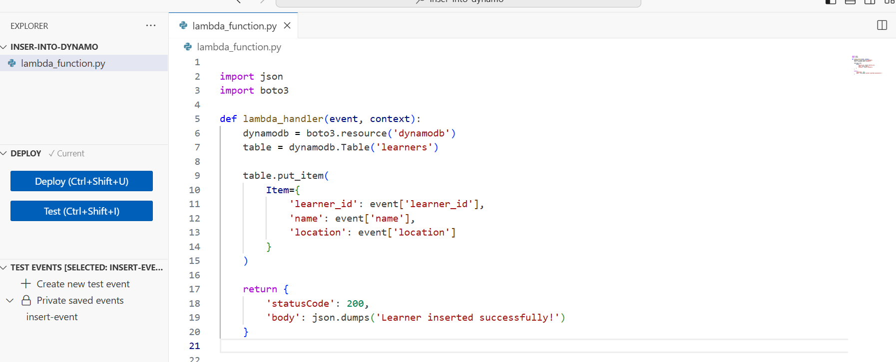
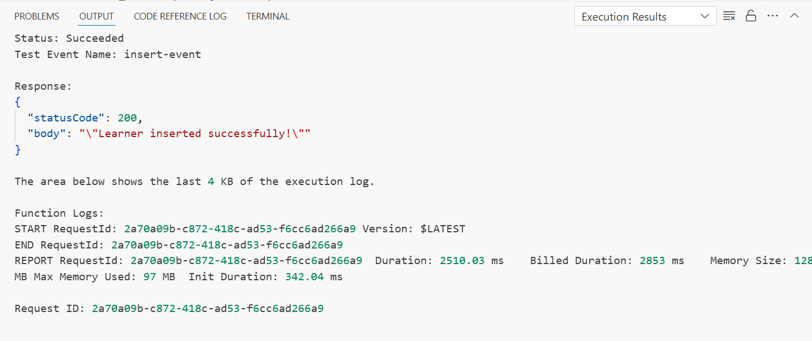
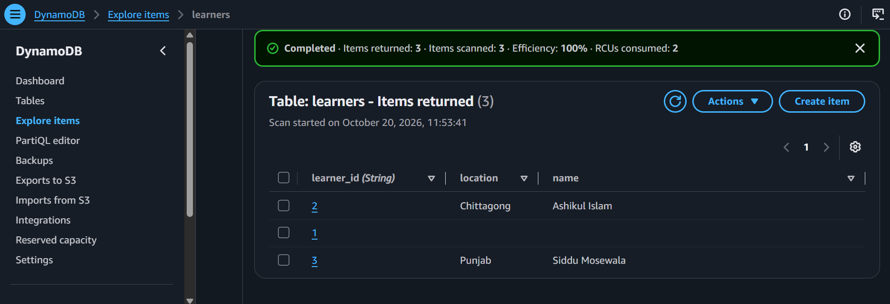
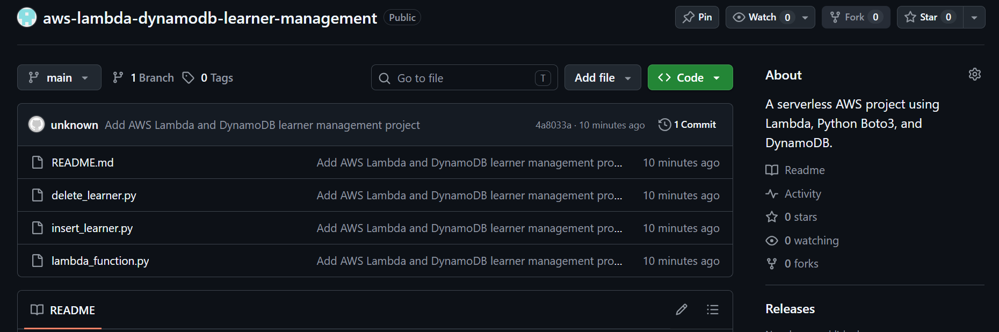

# AWS Serverless Learner Management System

**A serverless database application built with AWS Lambda, Amazon DynamoDB, Python, and Boto3.**

[](https://aws.amazon.com/lambda/)
[](https://aws.amazon.com/dynamodb/)
[](https://www.python.org/)
[](https://boto3.amazonaws.com/v1/documentation/api/latest/index.html)

## Overview

The **AWS Serverless Learner Management System** is a hands-on cloud project that demonstrates how to perform database operations using event-driven AWS Lambda functions and Amazon DynamoDB.

The application is organized into three Lambda handler examples that insert, retrieve, and delete learner records. Each handler uses Python and the AWS SDK for Python (Boto3) to interact with a DynamoDB table.

This project demonstrates foundational skills relevant to **Cloud Support, AWS Cloud Engineering, and entry-level DevOps** roles.

## Architecture

```text
             Test Event / Invocation
                       |
                       v
              +------------------+
              |    AWS Lambda    |
              |                  |
              |  Python + Boto3  |
              +------------------+
                       |
                       | AWS SDK API calls
                       v
              +------------------+
              | Amazon DynamoDB  |
              |                  |
              | Table: learners  |
              +------------------+
                       |
                       v
                 Learner Record
```

**Architecture components**

- **AWS Lambda:** Executes Python code in response to invocation events.
- **Amazon DynamoDB:** Stores learner records in a managed NoSQL database.
- **Boto3:** Enables Lambda functions to call DynamoDB APIs.
- **IAM execution role:** Grants the Lambda functions the permissions required to access the table.

*The diagram represents the intended application flow. Configure and verify each AWS resource before treating the architecture as fully deployed.*

## Features

### 1. Insert Learner
Creates or replaces a learner record in the `learners` table using DynamoDB's `put_item` operation.

### 2. Retrieve Learner
Retrieves a learner record by its `learner_id` using DynamoDB's `get_item` operation.

### 3. Delete Learner
Deletes a learner record by its `learner_id` using DynamoDB's `delete_item` operation.

## Technology Stack

| Technology | Purpose |
|---|---|
| AWS Lambda | Serverless execution environment |
| Amazon DynamoDB | Managed NoSQL database |
| Python | Application logic |
| Boto3 | AWS service integration |
| AWS IAM | Access control for Lambda |
| Git | Source control |
| GitHub | Code hosting and portfolio documentation |

## Repository Structure

```text
aws-lambda-dynamodb-learner-management/
├── lambda_function.py    # Retrieve learner
├── insert_learner.py     # Insert learner
├── delete_learner.py     # Delete learner
├── screenshots/          # Project evidence
└── README.md             # Documentation
```

## Database Design

**Table name:** `learners`

**Partition key:** `learner_id` (String)

Example learner record:

```json
{
  "learner_id": "2",
  "name": "Ashikul Islam",
  "location": "Chittagong"
}
```

The `learner_id` value uniquely identifies each item in this table. The actual DynamoDB key type must match the type used in the table configuration.

## Example Lambda Test Events

### Insert learner

Use the following JSON event when testing the insert handler:

```json
{
  "learner_id": "2",
  "name": "Ashikul Islam",
  "location": "Chittagong"
}
```

### Retrieve learner

```json
{
  "learner_id": "2"
}
```

### Delete learner

```json
{
  "learner_id": "2"
}
```

The event structure must match the fields accessed by each Lambda handler. Adapt these examples if your current function code expects additional fields.

## Setup and Configuration

1. Create an Amazon DynamoDB table named `learners` with `learner_id` as the partition key.
2. Create the required Lambda functions and configure their Python runtime.
3. Add the corresponding handler code from this repository to each function.
4. Configure the Lambda execution role with the necessary DynamoDB permissions for the target table.
5. Invoke each function using the relevant test event.
6. Verify the results in the Lambda test output and DynamoDB console.

For a typical implementation, the required permissions include `dynamodb:PutItem`, `dynamodb:GetItem`, and `dynamodb:DeleteItem`. Grant each function only the permissions it needs, scoped to the relevant table ARN.

## Screenshots

Screenshots provide visual evidence of the implementation and AWS console workflow.

### Lambda Function Code


### Successful Lambda Test


### DynamoDB Table Record


### GitHub Repository


## Security Considerations

- Use IAM execution roles instead of hardcoded AWS access keys.
- Follow the principle of least privilege when granting DynamoDB permissions.
- Never commit credentials, access keys, tokens, or other sensitive configuration.
- Avoid exposing personal or sensitive information in screenshots and test records.
- Review AWS resource permissions and costs when the project is deployed.

## Skills Demonstrated

- Event-driven serverless application fundamentals
- AWS Lambda configuration and invocation
- DynamoDB item operations
- Python integration with AWS services using Boto3
- IAM permissions and least-privilege access
- JSON event handling and cloud troubleshooting
- Git-based version control and technical documentation

## Future Improvements

Potential next steps for extending this project include:

- Add input validation and structured error handling.
- Return consistent JSON responses with appropriate status codes.
- Add automated unit tests using `pytest` and mock AWS calls with `botocore.stub.Stubber` or `unittest.mock`.
- Add infrastructure as code using AWS SAM or Terraform.
- Configure structured logging and CloudWatch monitoring.
- Add an API Gateway endpoint to expose learner operations over HTTP.
- Implement automated deployment through GitHub Actions.

## Project Status

**Learning and portfolio project.**

This repository demonstrates the application code and documentation for basic Lambda–DynamoDB operations. Deployment, permissions, and each operation should be verified in AWS before being described as fully tested or production-ready.

## Author

**Ashikul Islam Sayed**

Aspiring Cloud / DevOps Engineer | AWS | Linux | Networking | Python

[GitHub Profile](https://github.com/Ashikulislam-Sayed)
